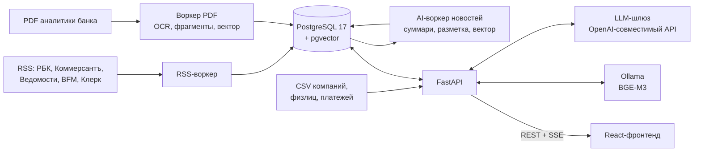

# Альфа-Новости

**Сервис, который превращает поток новостей в бизнес-решения для конкретной компании.**
Кейс хакатона Альфа-Банка «Превратить поток новостей в бизнес-решения».

Каждый день выходят сотни новостей, и почти все они не имеют отношения к конкретному
предпринимателю. Сервис забирает деловые новости из RSS, сопоставляет их с профилем компании
клиента банка и оставляет только значимые. По каждой такой новости он показывает, какие риски и
возможности она несёт, что думают аналитики банка и какие действия стоит рассмотреть. Каждый
вывод проверяется отдельной моделью и привязан к источнику.

**Демо-стенд:** https://alfa-news.mooo.com

| Тестовый вход | |
| --- | --- |
| Логин | `qa-front-2210@example.com` |
| Пароль | `qaFront2026!` |

На стенде все CSV (компании, физлица, платежи) уже импортированы и проиндексированы,
PDF аналитики банка обработаны и проиндексированы (OCR, фрагменты, векторы BGE-M3).
Можно сразу пользоваться сводкой и разбором событий.

---

## Что умеет сервис

| Возможность | Как работает |
| --- | --- |
| **Живая лента новостей** | Пять деловых источников (РБК, Коммерсантъ, Ведомости, Business FM, Клерк) опрашиваются каждые 1,5–5 минут. Новости дедуплицируются, получают тему и полный текст. |
| **Персональная сводка** | Для выбранной компании новости ранжируются по профилю: вектора BGE-M3, правила по ОКВЭД, региону и банковским продуктам, опциональный реранкер. Показывается и причина релевантности. |
| **Короткая оценка в ленте** | По каждой новости готовятся риски, возможности и позиция аналитиков банка. Карточки заполняются по мере готовности через SSE-поток, не блокируя ленту. |
| **Подробный разбор события** | Агент «Аналитик» пишет разбор, агент «Проверяющий» сверяет его с источниками. При замечаниях разбор переписывается. Текст приходит потоком, с этапами работы. |
| **Аналитика банка** | PDF загружаются через интерфейс, проходят OCR (rus+eng), режутся на фрагменты и индексируются. Гибридный поиск находит позицию банка по теме новости, со ссылкой на страницу PDF. |
| **Чат по новости** | Вопросы к готовому разбору. Ответ опирается только на подтверждённую интерпретацию. |
| **Профиль компании** | Загрузка CSV (компании, физлица, платежи) и автоматический профиль: ОКВЭД, выручка, продукты, регион, связи. |
| **Сохранённое, источники, Agent Trace** | Сохранённые события, первоисточники и путь от данных к выводу. |

## Принципы

- **Нет источника, нет цитаты.** Вывод, который проверяющий не подтвердил, не показывается как готовый.
- **Факт, аналитика банка и гипотеза ИИ разделены** и помечены в интерфейсе.
- **Недостаток данных виден пользователю.** Если данных не хватает, интерфейс говорит об этом и не домысливает.
- **Изоляция по компаниям.** Пользователь видит только компании, в которых состоит. Чужая и несуществующая компания дают одинаковый ответ 404.
- **Нет скрытых подмен.** Без настроенной LLM сервис отвечает 503. Демо-режим включается только явно (`AI_LLM_MOCK=true`) и помечается как демонстрационный.
- **Фоновые AI-задачи не блокируют API.** Тяжёлые вызовы выполняются воркерами, транзакция БД во время вызова модели не удерживается.

## Архитектура



**Путь новости до пользователя**

1. **Сбор.** RSS-воркер скачивает ленты и сохраняет публикации и полный текст в PostgreSQL.
2. **Обогащение.** AI-воркер делает суммари и разметку каждой новости и считает вектор BGE-M3.
3. **Отбор.** Для компании ранжирование считает «косинус + правила», порог релевантности 0.35.
4. **Оценка.** Один вызов LLM готовит риски, возможности и позицию банка по найденным фрагментам PDF.
5. **Разбор.** По открытию новости цепочка Аналитик → Проверяющий → (доработка) выдаёт проверенную интерпретацию.
6. **Диалог.** Пользователь задаёт уточняющие вопросы по готовому разбору.

## Стек

| Слой | Технологии |
| --- | --- |
| Фронтенд | React 19, TypeScript, Vite, React Router, TanStack Query, CSS Modules |
| Бэкенд | Python 3.13, FastAPI, SQLAlchemy 2 (async), Alembic, uv |
| Данные | PostgreSQL 17, pgvector (HNSW, cosine) |
| AI | OpenAI-совместимый LLM-шлюз, BGE-M3 (Ollama), реранкер (опционально) |
| Документы | Tesseract OCR (rus+eng), гибридный поиск (полнотекстовый + векторный) |
| Безопасность | JWT (HS256), Argon2id, проверка членства в компании на каждом запросе |
| Инфраструктура | Docker Compose, nginx |

## Структура репозитория

```text
.
├── backend/    FastAPI-сервис, воркеры, миграции, тесты
│   ├── app/    api, models, repositories, schemas, services (rss, llm, analytics)
│   ├── alembic/
│   └── tests/
└── frontend/   React-приложение
    └── src/    api, auth, components, layout, pages, state
```

Исходные репозитории:
[бэкенд](https://github.com/ten00m/alfa-news-backend) и
[фронтенд](https://github.com/savagewl/alpha-news-front).

Подробности по каждой части: [backend/README.md](backend/README.md) (API, форматы CSV, настройки AI и RSS)
и [frontend/README.md](frontend/README.md).

## Быстрый старт

Нужны Docker с Compose и Node.js 22.

### 1. Бэкенд

```bash
cd backend
cp .env.example .env
```

В `.env` задайте:

- `JWT_SECRET` — случайная строка от 32 символов: `python3 -c "import secrets; print(secrets.token_hex(48))"`;
- `AI_LLM_API_KEY` — ключ LLM-шлюза (остальные параметры шлюза в `.env.example` уже заполнены).

```bash
docker compose up --build -d --wait
```

Compose поднимет PostgreSQL с pgvector, применит миграции, запустит API и Ollama.
При первом запуске Ollama скачает модель `bge-m3`, это займёт несколько минут.

- Swagger UI: http://localhost:8000/docs
- Проверка: `curl http://localhost:8000/health/ready`

Без ключа LLM лента и поиск работают, но разбор новостей вернёт 503. Для демонстрации без модели
поставьте `AI_LLM_MOCK=true`: ответы будут помечены как демонстрационные.

### 2. Фронтенд

```bash
cd frontend
cp .env.example .env
```

В `.env` укажите локальный бэкенд:

```env
VITE_PROXY_TARGET=http://localhost:8000
VITE_PROXY_STRIP_API=1
```

```bash
npm install
npm run dev
```

Приложение откроется на http://localhost:5173. Без `.env` фронтенд работает с демо-стендом.

### 3. Данные для работы

1. Зарегистрируйтесь на странице входа.
2. Откройте «Компании» и загрузите CSV с компаниями (формат колонок описан в [backend/README.md](backend/README.md#загрузка-csv-бизнес-контекста)).
   Дополнительно можно загрузить физлиц и платежи.
3. Дождитесь, пока воркеры соберут новости и посчитают векторы (обычно несколько минут после старта).
4. Загрузите PDF аналитики банка, чтобы в разборах появилась позиция аналитиков.

## Сценарий демонстрации

1. **Вход и выбор компании.** Компания переключается в шапке.
2. **Сводка дня.** Новости, отобранные под профиль компании, с причиной релевантности. Карточки с рисками и возможностями дозаполняются по мере готовности оценки.
3. **Разбор события.** Открываем новость и видим этапы работы агента, затем текст разбора: факты, позиция банка, интерпретация ИИ, риски, возможности и рекомендуемые действия.
4. **Источники и Agent Trace.** Проверяем, на что опирается каждый вывод: новость, страница PDF банка, профиль компании.
5. **Чат.** Задаём вопрос по разбору и получаем ответ в рамках подтверждённых данных.
6. **Аналитика банка.** Загружаем PDF и смотрим, как он попадает в разборы.

В приложении есть раздел «Карта экранов» с короткой демонстрационной траекторией на 2–3 минуты.

## Качество и проверки

```bash
# бэкенд (без внешних сервисов)
cd backend && uv sync --locked && uv run pytest && uv run ruff check .

# фронтенд
cd frontend && npm ci && npm run lint && npm test && npm run build
```

Интеграционные тесты бэкенда запускаются отдельно, при заданных `*_TEST_POSTGRES_DB`
(см. [backend/README.md](backend/README.md)).

## Ограничения текущей версии

- Корпус новостей ограничен пятью RSS-источниками и их окном публикаций, архив не восстанавливается.
- AI-часть требует доступа к LLM-шлюзу и ключа. Без них разбор новостей недоступен.
- Страницы «Как это работает», «Безопасность» и «Карта экранов» описывают целевую архитектуру и содержат иллюстративные данные. Главная страница банка в интерфейсе остаётся прототипом.
- Целевые показатели качества (точность отбора ≥ 85%, релевантность ≥ 4/5, 100% подтверждённых фактов) заявлены как цели, а не измеренные значения.
